<div align="center">
  

  <br />

  <a href="https://github.com/Paigalashanker">
    
  </a>
  <a href="https://github.com/Paigalashanker?tab=repositories">
    
  </a>

  <br /><br />

  
</div>

<br />

> **I turn curious questions into practical systems — one experiment, commit, and debug session at a time.**

<br />

## `01 / IDENTITY`

I am a B.Tech student focused on **AI & Data Science**, building at the intersection of
machine learning, computer vision, robotics, and software development. I am currently
deepening my work with **ROS2**, cybersecurity, and the craft of shipping useful ideas.

<table>
  <tr>
    <td width="33%" align="center"><strong>AI + DATA</strong><br /><sub>models · signals · insight</sub></td>
    <td width="33%" align="center"><strong>ROBOTICS</strong><br /><sub>motion · control · ROS2</sub></td>
    <td width="33%" align="center"><strong>SYSTEMS</strong><br /><sub>software · tools · delivery</sub></td>
  </tr>
</table>

## `02 / CURRENT VECTOR`

| FOCUS | STATE | SIGNAL |
| :--- | :---: | :--- |
| Artificial Intelligence | `ACTIVE` | learning patterns and building useful models |
| Computer Vision | `ACTIVE` | turning pixels into decisions |
| Robotics / ROS2 | `TRAINING` | connecting code to the physical world |
| Full-Stack Development | `BUILDING` | shipping complete, useful flows |
| Cybersecurity | `EXPLORING` | understanding how systems fail and recover |
| Competitive Programming | `REPEATING` | sharpening problem-solving fundamentals |

## `03 / TOOLCHAIN`

<div align="center">

**LANGUAGES**


**AI / DATA**


**ROBOTICS / WEB / TOOLS**


</div>

## `04 / SELECTED BUILDS`

| PROJECT | SIGNAL | STATUS | REPOSITORY |
| :--- | :--- | :--- | :---: |
| **Resource Hub** | A practical web resource collection for developers. | `SHIPPED` | [ENTER](https://github.com/Paigalashanker/resource-hub) |
| **AI URL Detector** | Exploring machine learning for suspicious URL detection. | `BUILDING` | [ENTER](https://github.com/Paigalashanker/ai_based_phishing_detection) |
| **e-Yantra Robotics** | Robotics experimentation and engineering projects. | `BUILDING` | [ENTER](https://github.com/Paigalashanker/Avishkar) |
| **DSA in Java** | Data structures and algorithms, implemented through practice. | `ACTIVE` | [ENTER](https://github.com/Paigalashanker/dsa-in-java) |

## `05 / SYSTEM STATUS`

<div align="center">


<br>


</div>

## `06 / CONTRIBUTION SIGNAL`

<div align="center">

<sub>EVERY SQUARE REPRESENTS A SMALL STEP FORWARD</sub>

<br><br>


<br>

`KEEP BUILDING.`

</div>

## `07 / LOOP`

```text
01 — LEARN       04 — DEBUG
02 — BUILD       05 — DEPLOY
03 — BREAK       06 — REPEAT
```

## `08 / CURRENT MISSION`

```text
MISSION   // Build useful AI systems
FOCUS     // AI · Robotics · Computer Vision
STATUS    // ACTIVE
```

## `09 / TRANSMISSION`

<div align="center">

[GITHUB](https://github.com/Paigalashanker)

<br><br>

> **Discipline creates the aura.**

</div>
